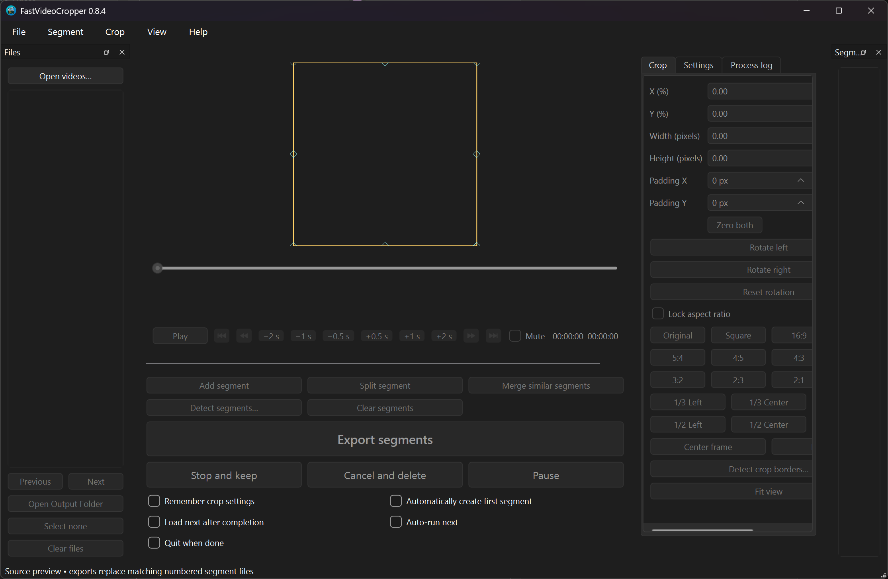

# FastVideoCropper

Crop, trim, and export video segments on Windows.

## Features

- Drag-and-drop video files and folders.
- Detect scenes and adjust crops for individual segments.
- Resize, rotate, and crop with aspect-ratio presets and pixel padding.
- Export HEVC video with original audio using CPU or GPU encoding.

## Install

- Download the `.exe` installer from the [latest release](https://github.com/electblake/fastvideocropper/releases/latest).
- Run Setup on Windows x64; an internet connection is required during installation.
- Launch FastVideoCropper from the Start menu. Playback and export work offline.
- See the [user guide](docs/usage.md) or [development guide](docs/development.md) for details.

